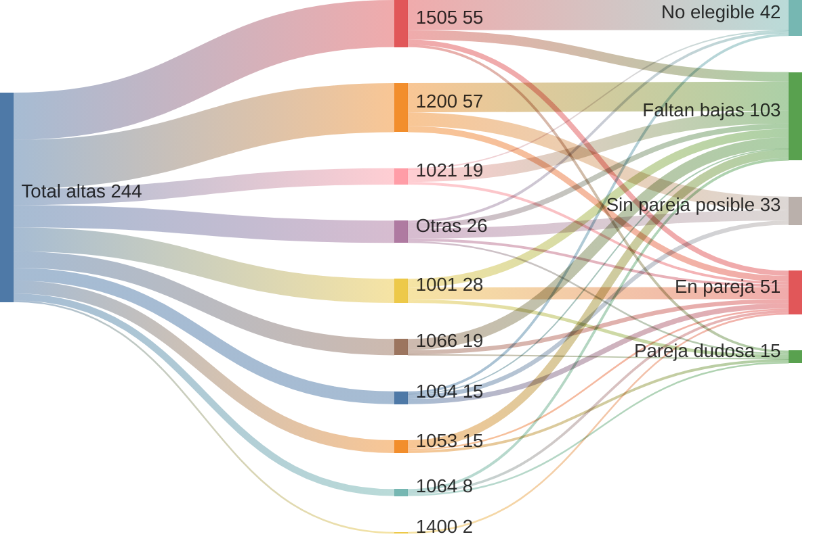
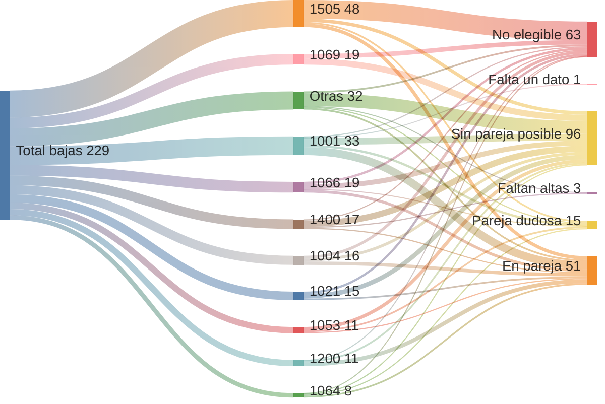
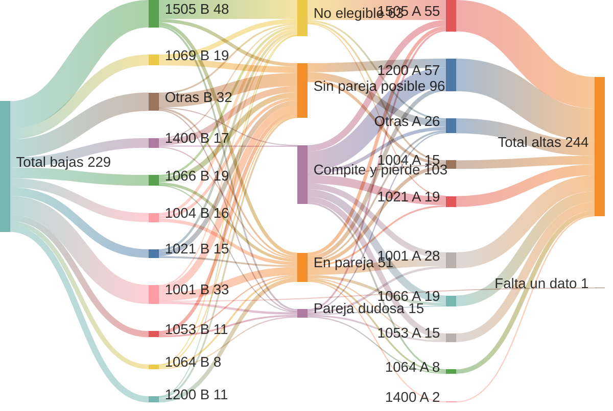
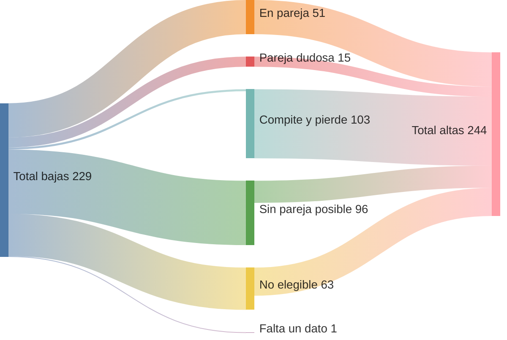
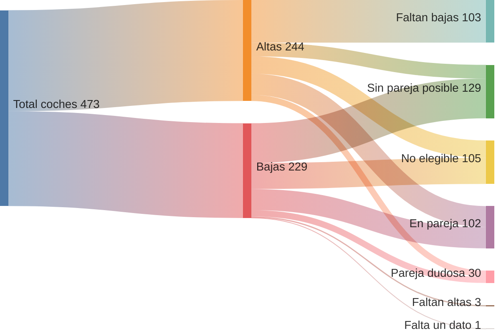
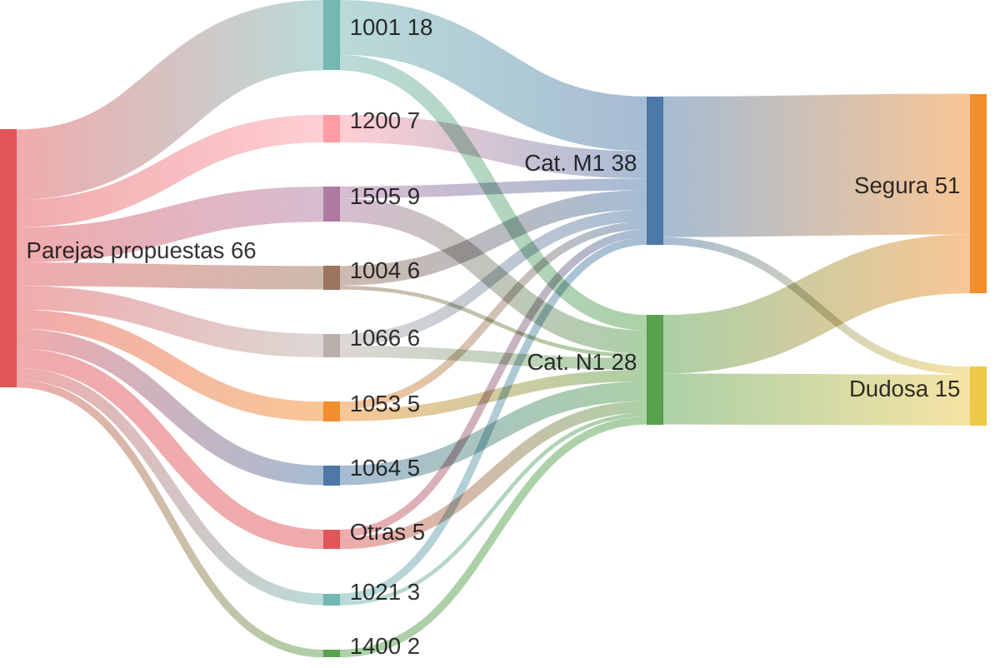

# Sankey de altas y bajas · 2026-10-29

- Foto del 2026-10-29: las 473 fichas de `03_coches/` (244 altas y 229 bajas) cruzadas con `emparejar_v4.py`. No se regenera sola.
- Cada coche cuenta 1. Una pareja son 2 unidades: 66 parejas son 66 altas + 66 bajas = 132.
- Qué significa cada desenlace:
    - En pareja: entra en una de las 51 parejas propuestas sin siniestro.
    - Pareja dudosa: entra en una de las 15 parejas cuya baja salió por siniestro. Solo según el Excel («CANCELADO POR SINIESTRO»); en general no se pueden presentar. El emparejador las usa solo cuando no hay una pareja sin siniestro para ese hueco.
    - Faltan bajas (en altas) / Faltan altas (en bajas): tiene compañeros admisibles, pero todos están ya emparejados con otro coche; en un emparejamiento máximo no queda ninguno libre. 103 altas y 3 bajas. En el 1c van juntos como «Compite y pierde».
    - Sin pareja posible: pasa las reglas del coche, pero no tiene ningún compañero que cumpla R1 Sociedad, R4b Misma subcategoría y R5 Ventana, ni ocupado ni libre. 33 altas y 96 bajas.
    - Falta un dato: solo tiene aristas SIN_DATOS. 1 baja (0894LKM, sin fecha de salida).
    - No elegible: alguna regla del coche en FALLA. 42 altas y 63 bajas.
- Sociedades por su código. Las de menos de 15 coches, juntas en «Otras». Códigos:
    - 1001: AVSA
    - 1004: G.O.MEDIOAMBIENTE S.L.
    - 1021: MEDICION AVANZADA CONTAD.
    - 1053: ISG
    - 1064: AYWA SER.AMBIENTALES SL
    - 1066: CANALIZ. CIVILES S.A.
    - 1069: JEMAR E HIJOS S.L.
    - 1200: EMIVASA
    - 1400: EGEVASA
    - 1505: CGAC
- Las etiquetas van sin tildes ni eñes: el sankey de Mermaid no las admite y el diagrama no compila.

## 1a · Altas: total → sociedad → estado

## 1b · Bajas: total → sociedad → estado

## 1c · Bajas y altas juntas

- Bajas a la izquierda («1505 B»), altas a la derecha («1505 A»); se juntan en el estado, en el centro.
- «En pareja» y «Pareja dudosa» quedan equilibrados: 51 y 15 bajas entran, 51 y 15 altas salen.
- En el resto de estados la entrada y la salida no cuadran: el nodo toma el ancho del lado mayor.

## 1d · Bajas y altas juntas, sin sociedades

- Lo mismo que el 1c, sin el paso por sociedad: 229 bajas a la izquierda, 244 altas a la derecha.
- «Falta un dato» solo tiene una baja (0894LKM) y ninguna alta; va abajo y en el centro (alineación a la izquierda y orden de las filas).

## 2 · Total → rol → desenlace

- Altas y bajas comparten los nodos «En pareja», «Pareja dudosa», «Sin pareja posible» y «No elegible»: el ancho suma los dos roles.

## 3 · Las 66 parejas: sociedad → categoría → segura o dudosa

- Sociedad y categoría del alta (en pareja, la de la baja es la misma por R1 Sociedad y R4b Misma subcategoría).
- Segura: 51 parejas sin siniestro. Dudosa: 15 parejas cuya baja salió por siniestro según el Excel.

