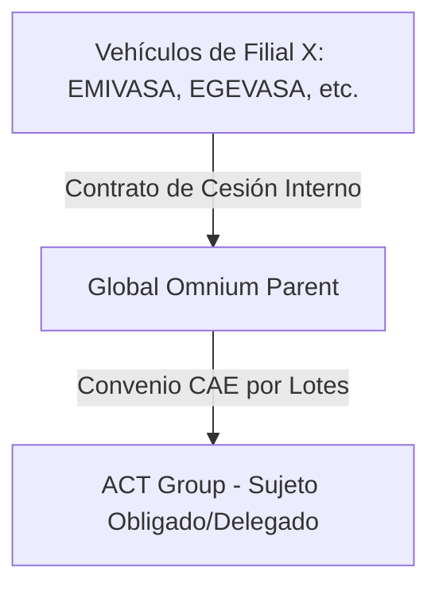

# Requisitos de la Campaña - Proyecto Global Omnium 📋🛡️

Este documento recopila el contexto del cliente, la estructura de la campaña, la cadena de trazabilidad de los ahorros energéticos y las condiciones de validación para los expedientes del lote corporativo **Global Omnium** bajo la ficha **TRA050 v1.1**.

---

## 🏛️ 1. Contexto de Global Omnium y Estructura del Grupo

**Global Omnium** es un grupo empresarial líder en la gestión y tratamiento del ciclo completo del agua. Su actividad principal abarca:
* **Extracción de recursos hídricos** (pozos, captaciones, acuíferos).
* **Producción y potabilización de agua** (plantas de tratamiento ETAP, desoladoras).
* **Distribución y saneamiento** (mantenimiento y explotación de redes de distribución urbana y depuración EDAR).

### Estructura de Sociedades (Filiales)
Debido a la naturaleza descentralizada de los servicios públicos municipales y las concesiones locales, el grupo se divide en una gran cantidad de filiales, empresas mixtas y Uniones Temporales de Empresas (UTEs). Cada una gestiona activos y flotas de vehículos de forma independiente.

Las principales sociedades y filiales identificadas en el inventario son:
* **AGUAS DE VALENCIA SA** (AVSA)
* **EMPRESA MIXTA VALENCIANA DE AGUAS SA** (EMIVASA)
* **EGEVASA** (Diputación de Valencia)
* **E.Mixta Metropolitana, SA** (Depuración de Valencia)
* **GAMASER** (Laboratorio y control de calidad)
* **CGAC** (Cataluña)
* **ARAGONESA SER.PUBLICOS SL** (Aragón)
* **EMPRESA MIXTA CALPE** / **MORELLA** / **AIGÜES DE SAGUNT, S.A.** (Concesiones locales)
* **FUCSA** / **SASTESA** / **CANALIZ. CIVILES S.A.** (Obra y mantenimiento de redes)
* **UTEs de Explotación** (ej: UTE EDAR TABLADA, UTE CHIVA, UTE CAMPO CARTAGENA, UTE SOFTCAD-VANAGUA)

---

## 🔄 2. Procedimiento de Centralización de Ahorros (Cadena de Custodia)

A pesar de que los vehículos nuevos y antiguos pertenecen a múltiples filiales (Empresa X), a efectos de la emisión de Certificados de Ahorro Energético (CAE) se ha definido un **procedimiento de centralización a través de Global Omnium**.

Para garantizar la validez legal ante el verificador acreditado y evitar la fragmentación en cientos de convenios, la cesión de ahorros se estructurará en dos niveles:

1. **Contrato de Cesión Interno (Nivel 1):**
   * Un contrato de cesión de ahorros energéticos entre la **Filial X** (como Cedente original del ahorro) y **Global Omnium** (como Cesionario y centralizador).
   * Este contrato justifica que Global Omnium adquiere legalmente los derechos sobre los kWh acumulados por la flota de esa filial.
2. **Convenio CAE Final (Nivel 2):**
   * Convenio de cesión de ahorros final entre **Global Omnium** (como Cedente centralizador) y **ACT Group** (como Sujeto Obligado/Delegado que tramita los CAEs).
3. **Estrategia de Lotes:**
   * La firma de los Convenios CAE finales de Global Omnium con ACT Group se organizará **por lotes consolidados** (por ejemplo, agrupando las actuaciones por año de compra de vehículo nuevo y Comunidad Autónoma de la actuación) para simplificar la firma digital final por parte de los representantes autorizados.

---

## 📄 3. Requisitos Documentales y Renting

Dado que la mayor parte de la flota de Global Omnium está gestionada a través de contratos de renting corporativos con financieras, aplicamos la actualización del criterio del organismo rector:

### A. Justificantes del Vehículo Nuevo (Alta):
1. **Factura de Adquisición/Renting:** Factura emitida por el concesionario o la empresa de renting. Debe incluir la matrícula, marca, modelo y número de bastidor (VIN).
2. **Permiso de Circulación Nuevo:** Matriculado a nombre de la empresa de renting o de la filial (en el primer caso, acompañado del contrato de renting correspondiente).
3. **Ficha Técnica (eITV):** Certificado con el consumo homologado $CVN$ (en kWh/100km).

### B. Justificantes del Vehículo Antiguo (Baja):
1. **Ficha Técnica Antigua:** ITV del vehículo de combustión viejo para catalogación y consumos.
2. **Justificante de Posesión Antigua (Umbrales de Duración):**
   * **Caso Propiedad (1 Año):** Si el coche era propiedad de la filial, Permiso de Circulación antiguo o recibo del IVTM que demuestre la titularidad de la filial durante al menos **1 año (365 días)**.
   * **Caso Renting (2 Años - Criterio Oficial):** Si el coche sustituido estaba en régimen de renting, es obligatorio demostrar una posesión mínima de **2 años (730 días)** entregando en lugar del justificante de propiedad:
     * a) Contrato de la operación de renting en el que figure la filial solicitante como arrendataria/usuario.
     * b) Acta de entrega del vehículo firmada en conformidad entre el arrendador y el arrendatario/usuario.
3. **Acreditación de la Baja / Pérdida de Posesión:**
   * **Caso Propiedad:** Certificado de destrucción o solicitud de cambio de titularidad en DGT.
   * **Caso Renting:** Acta de devolución del vehículo antiguo al proveedor de renting, acreditando su entrega física y la finalización de su uso.

---

## ⚙️ 4. Reglas de Validación y Consistencia del Código

El motor de reglas de [rules.py](file:///home/msimarro/03_code/tra050/src/tra050_auditor/rules.py) comprobará:

* **Posesión Dinámica:** 
  * Si `es_renting` = `True` $\rightarrow$ Validar posesión $\ge$ 730 días.
  * Si `es_renting` = `False` $\rightarrow$ Validar propiedad $\ge$ 365 días.
* **Trazabilidad de la Cesión:**
  * Verificar la presencia física de ambos contratos de cesión (Contrato Interno Filial $\rightarrow$ Global Omnium y Convenio CAE Colectivo Global Omnium $\rightarrow$ ACT Group).
* **Consistencia de NIF y Nombres:**
  * El NIF y nombre en las facturas de alta y contratos de renting debe coincidir con la Filial X correspondiente.

## 🔗 5. Reglas de emparejamiento alta ↔ baja

Las seis reglas que decide el emparejador y que cada expediente de `03_expedientes/` verifica una a una. Venian del indice de las fichas de emparejamiento, retirado el 2026-08-19.

| # | Regla | Umbral |
| :- | :--- | :--- |
| R1 | Misma sociedad del grupo | `Cod.Sociedad` alta = baja |
| R2 | Posesion minima | 365d en propiedad / 730d si se tuvo por contrato. **Cuentan los dias reales de posesion acreditados por contrato**, no la antiguedad del vehiculo ni la etiqueta que le ponga el Excel. Ver el apartado de abajo |
| R3 | Alta electrica pura; baja de combustion, **hibrido incluido** (solo se excluye el electrico puro como sustituido) | |
| R4 | Misma categoria | no se admite sustitucion entre categorias |
| R5 | Ventana | −3 / +6 meses |
| R6 | Ambito CAE | adquisicion posterior al 2023-01-25 |

## R2: que cuenta como posesion (criterio del 2026-08-19)

Cuestion cerrada por el usuario. Se cierra en dos mitades, y hay que aplicar las dos:

**1. La denominacion del contrato no descarta.** El criterio 25-11.01 no exige que el contrato se llame de una forma concreta; exige posesion efectiva de mas de dos anos y que ya no lo este. Que el Excel etiquete un contrato como `ALQUILER_CORTA_DURACION` no lo tumba por si solo.

**2. Lo que descarta es el tiempo real.** Un alquiler de corta duracion decae **porque el vehiculo estuvo menos de dos anos en poder del solicitante**, no por como se llame. Y ese tiempo se mide **del contrato**, entre `fecha_inicio` y `fecha_fin`.

> ⛔ **Contar desde la matriculacion no vale nunca.** Prueba la edad del coche, no que lo tuviera el solicitante. Cualquier pareja que solo se sostenga por esa via esta incumpliendo R2, aunque el numero pase de 730.

Consecuencia de aplicarlo al ejercicio 2023 (2026-08-19):

| Expediente | Posesion real | Veredicto |
| :--- | ---: | :--- |
| `5566KSD ← 6994KGK` | 815d | **se salva** aunque el Excel lo llame alquiler de corta duracion → `A_ACREDITADO` |
| `0767MJM ← 5875KPY` | 149d | decae → **retirado** |
| `2120MFK ← 4535KFH` | 230d | decae → **retirado** |

Los dos que decaen **no tienen baja sustituta**: el barrido de las 44 bajas de CGAC dejo una sola compatible, `6586KPD`, ya asignada a `2076MJP`. Detalle en cada nota de expediente.

El criterio se aplico a **toda la campana**, no solo a 2023. Barrido de las 69 parejas: cuatro tienen la posesion real por debajo del umbral y **ninguna tiene sustituta libre**.

| Expediente | Ejercicio | Sociedad | Posesion real | Alternativas |
| :--- | :-: | :--- | ---: | :--- |
| `0767MJM ← 5875KPY` | 2023 | CGAC | 149d | solo `6586KPD`, ocupada |
| `2120MFK ← 4535KFH` | 2023 | CGAC | 230d | solo `6586KPD`, ocupada |
| `1066MWL ← 1947LMM` | 2024 | CGAC | 372d | `0019LLR` y `9413LKC`, ocupadas |
| `1108KHK ← 2653LTG` | 2024 | G.O. Medioambiente | 30d | `9019LBN`, ocupada |

**Las cuatro decaen.** Es un patron, no cuatro casos sueltos: son los unicos alquileres de corta duracion de la campana, todos con NORTHGATE o AYVENS, y el unico que se salva es `6994KGK` porque su alquiler duro 815 dias.

### Una pareja que no se sostiene no es un expediente

**Criterio del usuario del 2026-08-19.** Cuando una pareja incumple una regla y no tiene arreglo, **no se queda marcada: se retira**. Un expediente es una cosa real; dejar dentro de `03_expedientes/` emparejamientos que no se pueden presentar ensucia todos los recuentos y obliga a filtrar en cada consulta.

El procedimiento, que es el mismo de siempre porque **nada se borra**:

1. La nota de la pareja se mueve a `03_expedientes/0bsoleto/<fecha>_<motivo>/`, con un `LEEME.md` que explique por que decayo y que se busco antes de retirarla.
2. **El alta vuelve a `_SIN_PAREJA.md`**: sigue siendo elegible y sigue buscando vehiculo sustituido.
3. **La baja va a `_NO_ELEGIBLES.md`** si el motivo la descarta para cualquier pareja (posesion corta, categoria, combustible); si solo fallaba para esa alta concreta, vuelve tambien a `_SIN_PAREJA.md`.
4. En las fichas de vehiculo se restituye el vocabulario que ya usa la campana: `estado_emparejamiento: ELEGIBLE_SIN_PAREJA` o `NO_ELEGIBLE`, `estado_posesion: INSUFICIENTE`, `coche_emparejado: SIN_EMPAREJAMIENTO`.

Por eso **no existe ningun nivel de «no viable»** ni ninguna clave `viable` en el YAML: seria informacion sobre algo que ya no esta. El vocabulario de `nivel` sigue siendo `A_ACREDITADO` · `B_INDICIO` · `C_CONDICIONADO`, y los tres describen expedientes reales en distinto grado de acreditacion.

> Lo aplicado el 2026-08-19: las cuatro parejas de la tabla anterior se fueron a `03_expedientes/0bsoleto/2026-08-19_parejas_no_viables_r2/`. La campana pasa de **69 a 65 expedientes**; `_SIN_PAREJA.md` de 278 a 282 vehiculos y `_NO_ELEGIBLES.md` de 74 a 78.

