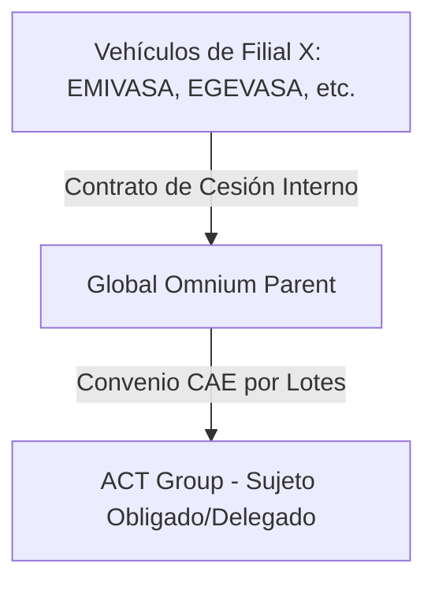

# Requisitos de la Campaña - Proyecto Global Omnium 📋🛡️

Contexto cliente, estructura campaña, cadena trazabilidad ahorros energéticos y condiciones validación de expedientes lote corporativo **Global Omnium**, ficha **TRA050 v1.1**.

---

## 🏛️ 1. Contexto de Global Omnium y Estructura del Grupo

**Global Omnium**: grupo líder en gestión y tratamiento ciclo completo del agua. Actividad:
* **Extracción recursos hídricos** (pozos, captaciones, acuíferos).
* **Producción y potabilización** (plantas ETAP, desoladoras).
* **Distribución y saneamiento** (redes distribución urbana, depuración EDAR).

### Estructura de Sociedades (Filiales)
Servicios municipales descentralizados y concesiones locales → grupo dividido en muchas filiales, empresas mixtas y UTEs. Cada una gestiona activos y flotas independiente.

Sociedades principales en inventario:
* **AGUAS DE VALENCIA SA** (AVSA)
* **EMPRESA MIXTA VALENCIANA DE AGUAS SA** (EMIVASA)
* **EGEVASA** (Diputación de Valencia)
* **E.Mixta Metropolitana, SA** (Depuración de Valencia)
* **GAMASER** (Laboratorio y control de calidad)
* **CGAC** (Cataluña)
* **ARAGONESA SER.PUBLICOS SL** (Aragón)
* **EMPRESA MIXTA CALPE** / **MORELLA** / **AIGÜES DE SAGUNT, S.A.** (Concesiones locales)
* **FUCSA** / **SASTESA** / **CANALIZ. CIVILES S.A.** (Obra y mantenimiento de redes)
* **UTEs de Explotación** (ej: UTE EDAR TABLADA, UTE CHIVA, UTE CAMPO CARTAGENA, UTE SOFTCAD-VANAGUA)

---

## 🔄 2. Procedimiento de Centralización de Ahorros (Cadena de Custodia)

Vehículos nuevos y antiguos de múltiples filiales (Empresa X), pero para emisión CAE: **centralización vía Global Omnium**.

Validez legal ante verificador acreditado y evitar cientos de convenios → cesión en dos niveles:

1. **Contrato de Cesión Interno (Nivel 1):**
   * Cesión ahorros entre **Filial X** (Cedente original) y **Global Omnium** (Cesionario, centralizador).
   * Justifica que Global Omnium adquiere legalmente derechos sobre kWh de flota de esa filial.
2. **Convenio CAE Final (Nivel 2):**
   * Convenio final entre **Global Omnium** (Cedente centralizador) y **ACT Group** (Sujeto Obligado/Delegado que tramita CAEs).
3. **Estrategia de Lotes:**
   * Convenios CAE finales Global Omnium–ACT Group firmados **por lotes consolidados** (ej: por año compra vehículo nuevo y Comunidad Autónoma) para simplificar firma digital de representantes autorizados.

---

## 📄 3. Requisitos Documentales y Renting

Mayoría flota Global Omnium en renting corporativo con financieras → aplica criterio actualizado del organismo rector:

### A. Justificantes del Vehículo Nuevo (Alta):
1. **Factura Adquisición/Renting:** de concesionario o empresa renting. Incluye matrícula, marca, modelo, bastidor (VIN).
2. **Permiso Circulación Nuevo:** a nombre de empresa renting o filial (primer caso: con contrato renting).
3. **Ficha Técnica (eITV):** consumo homologado $CVN$ (kWh/100km).

### B. Justificantes del Vehículo Antiguo (Baja):
1. **Ficha Técnica Antigua:** ITV vehículo combustión viejo, para catalogación y consumos.
2. **Justificante de Posesión Antigua (Umbrales de Duración):**
   * **Caso Propiedad (1 Año):** coche propiedad filial → Permiso Circulación antiguo o recibo IVTM demostrando titularidad filial mínimo **1 año (365 días)**.
   * **Caso Renting (2 Años - Criterio Oficial):** coche sustituido en renting → obligatorio posesión mínima **2 años (730 días)**, entregando en lugar de justificante propiedad:
     * a) Contrato de la operación de renting en el que figure la filial solicitante como arrendataria/usuario.
     * b) Acta de entrega del vehículo firmada en conformidad entre el arrendador y el arrendatario/usuario.
3. **Acreditación de la Baja / Pérdida de Posesión:**
   * **Caso Propiedad:** Certificado destrucción o solicitud cambio titularidad DGT.
   * **Caso Renting:** Acta devolución vehículo antiguo al proveedor renting, acreditando entrega física y fin de uso.

---

## ⚙️ 4. Reglas de Validación y Consistencia del Código

Motor reglas de [rules.py](file:///home/msimarro/03_code/tra050/src/tra050_auditor/rules.py) comprueba:

* **Posesión Dinámica:** 
  * `es_renting` = `True` $\rightarrow$ posesión $\ge$ 730 días.
  * `es_renting` = `False` $\rightarrow$ propiedad $\ge$ 365 días.
* **Trazabilidad de la Cesión:**
  * Presencia física ambos contratos (Interno Filial $\rightarrow$ Global Omnium y Convenio CAE Colectivo Global Omnium $\rightarrow$ ACT Group).
* **Consistencia de NIF y Nombres:**
  * NIF y nombre en facturas alta y contratos renting = Filial X correspondiente.

## 🔗 5. Reglas de emparejamiento alta ↔ baja

> **Superado el 2026-10-22.** Reglas activas en `00_control/REGLAS_EMPAREJAMIENTO.md` (R1 Sociedad a R9 Salida). Lo siguiente: criterio de agosto, conservado como historia.

Seis reglas del emparejador; cada expediente de `03_expedientes/` las verifica una a una. Venían del índice de fichas de emparejamiento, retirado 2026-08-19.

| # | Regla | Umbral |
| :- | :--- | :--- |
| R1 | Misma sociedad del grupo | `Cod.Sociedad` alta = baja |
| R2 | Posesion minima | 365d propiedad / 730d por contrato. **Cuentan dias reales de posesion acreditados por contrato**, no antiguedad vehiculo ni etiqueta del Excel. Ver apartado abajo |
| R3 | Alta electrica pura; baja combustion, **hibrido incluido** (solo excluido electrico puro como sustituido) | |
| R4 | Misma categoria | sin sustitucion entre categorias |
| R5 | Ventana | −3 / +6 meses |
| R6 | Ambito CAE | adquisicion posterior al 2023-01-25 |

## R2: que cuenta como posesion (criterio del 2026-08-19)

Cerrada por usuario. Dos mitades, aplicar ambas:

**1. Denominacion del contrato no descarta.** Criterio 25-11.01 no exige nombre concreto; exige posesion efectiva >2 anos y que ya no lo este. Etiqueta Excel `ALQUILER_CORTA_DURACION` no lo tumba por si sola.

**2. Descarta el tiempo real.** Alquiler corta duracion decae **porque vehiculo estuvo <2 anos en poder del solicitante**, no por nombre. Tiempo medido **del contrato**, entre `fecha_inicio` y `fecha_fin`.

> ⛔ **Contar desde matriculacion no vale nunca.** Prueba edad del coche, no que lo tuviera solicitante. Pareja sostenida solo por esa via incumple R2, aunque pase de 730.

Aplicado a ejercicio 2023 (2026-08-19):

| Expediente | Posesion real | Veredicto |
| :--- | ---: | :--- |
| `5566KSD ← 6994KGK` | 815d | **se salva** aunque Excel diga alquiler corta duracion → `A_ACREDITADO` |
| `0767MJM ← 5875KPY` | 149d | decae → **retirado** |
| `2120MFK ← 4535KFH` | 230d | decae → **retirado** |

Los dos que decaen **sin baja sustituta**: barrido de 44 bajas CGAC dejo una sola compatible, `6586KPD`, ya asignada a `2076MJP`. Detalle en cada nota de expediente.

Criterio aplicado a **toda la campana**, no solo 2023. Barrido 69 parejas: cuatro bajo umbral y **ninguna con sustituta libre**.

| Expediente | Ejercicio | Sociedad | Posesion real | Alternativas |
| :--- | :-: | :--- | ---: | :--- |
| `0767MJM ← 5875KPY` | 2023 | CGAC | 149d | solo `6586KPD`, ocupada |
| `2120MFK ← 4535KFH` | 2023 | CGAC | 230d | solo `6586KPD`, ocupada |
| `1066MWL ← 1947LMM` | 2024 | CGAC | 372d | `0019LLR` y `9413LKC`, ocupadas |
| `1108KHK ← 2653LTG` | 2024 | G.O. Medioambiente | 30d | `9019LBN`, ocupada |

**Las cuatro decaen.** Patron, no casos sueltos: unicos alquileres corta duracion de campana, todos NORTHGATE o AYVENS; unico salvado `6994KGK` porque alquiler duro 815 dias.

### Una pareja que no se sostiene no es un expediente

**Criterio usuario 2026-08-19.** Pareja que incumple regla sin arreglo **no se marca: se retira**. Expediente = cosa real; dejar en `03_expedientes/` emparejamientos no presentables ensucia recuentos y obliga a filtrar cada consulta.

Procedimiento de siempre, **nada se borra**:

1. Nota de pareja → `03_expedientes/0bsoleto/<fecha>_<motivo>/`, con `LEEME.md` explicando por que decayo y que se busco antes de retirar.
2. **Alta vuelve a `_SIN_PAREJA.md`**: sigue elegible, busca vehiculo sustituido.
3. **Baja va a `_NO_ELEGIBLES.md`** si motivo la descarta para cualquier pareja (posesion corta, categoria, combustible); si solo fallaba para esa alta, vuelve tambien a `_SIN_PAREJA.md`.
4. En fichas vehiculo se restituye vocabulario de campana: `estado_emparejamiento: ELEGIBLE_SIN_PAREJA` o `NO_ELEGIBLE`, `estado_posesion: INSUFICIENTE`, `coche_emparejado: SIN_EMPAREJAMIENTO`.

Por eso **no existe nivel «no viable»** ni clave `viable` en YAML: seria info sobre algo que ya no esta. Vocabulario `nivel` sigue `A_ACREDITADO` · `B_INDICIO` · `C_CONDICIONADO`; los tres = expedientes reales en distinto grado de acreditacion.

> Aplicado 2026-08-19: cuatro parejas de tabla anterior → `03_expedientes/0bsoleto/2026-08-19_parejas_no_viables_r2/`. Campana pasa de **69 a 65 expedientes**; `_SIN_PAREJA.md` de 278 a 282 vehiculos y `_NO_ELEGIBLES.md` de 74 a 78.